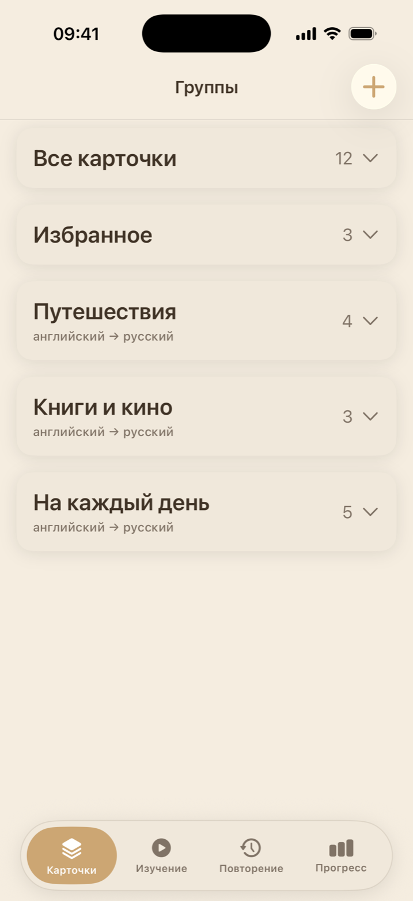
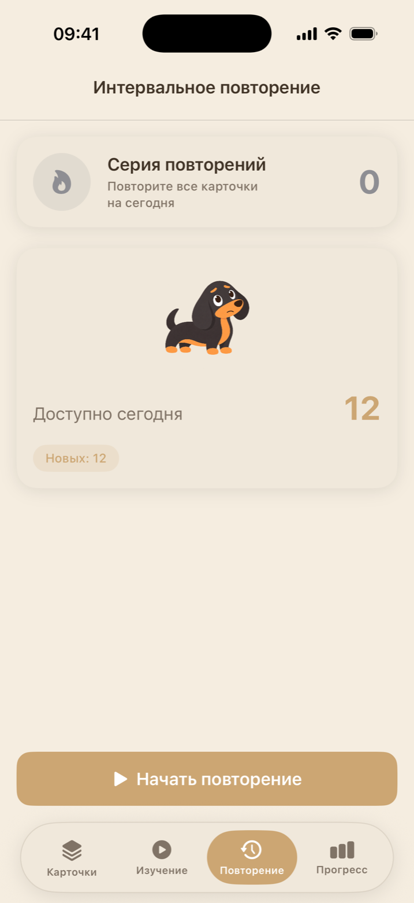
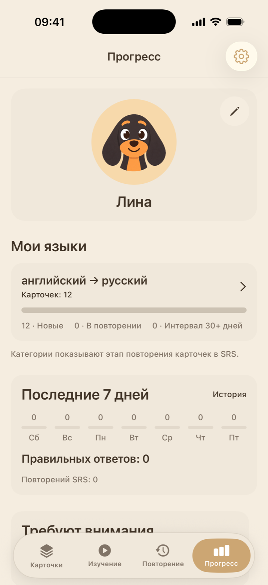
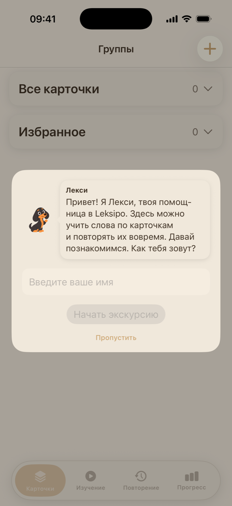

<p align="center">
  
</p>

<h1 align="center">Leksipo</h1>

<p align="center"><strong>Свой словарь. Повторение по расписанию.</strong></p>

<p align="center">
  Карточки для изучения слов на iPhone и iPad.<br>
  Собирай лексику из книг, занятий и разговоров, а Leksipo подскажет, что пора повторить.
</p>

<p align="center">
  
  
  
</p>

<p align="center">
  <a href="#как-проходит-тренировка">Тренировка</a> ·
  <a href="#скриншоты">Скриншоты</a> ·
  <a href="#возможности">Возможности</a> ·
  <a href="#сборка-и-тесты">Сборка и тесты</a>
</p>

## Как проходит тренировка

1. **Собери словарь.** Создай группу, выбери языки слова и перевода, добавь карточки вручную или импортируй список.
2. **Проверь себя.** Попробуй вспомнить перевод, переверни карточку и оцени, насколько легко дался ответ. Для практики без расписания есть свободный режим со свайпами.
3. **Вернись к словам вовремя.** В режиме интервального повторения Leksipo рассчитывает следующий показ для каждой карточки. Очередь на сегодня собрана на одном экране.

## Скриншоты

<table>
  <tr>
    <th>Личный словарь</th>
    <th>Повторения на сегодня</th>
    <th>Профиль и прогресс</th>
    <th>Знакомство с Лекси</th>
  </tr>
  <tr>
    <td align="center"></td>
    <td align="center"></td>
    <td align="center"></td>
    <td align="center"></td>
  </tr>
</table>

Скриншоты сделаны на iPhone 17 Pro в симуляторе. Для словаря использованы демонстрационные карточки.

## Возможности

| | Что умеет Leksipo |
| --- | --- |
| **Личный словарь** | Тематические группы, избранное, пояснения к карточкам и выбор языковой пары. |
| **Два режима практики** | Свободная тренировка по группе и интервальные повторения с ежедневной очередью. |
| **Импорт и резервные копии** | Добавление карточек из таблицы или JSON, экспорт и восстановление данных из резервной копии. |
| **Произношение** | Озвучивание слова и перевода с выбором из доступных системных голосов. |
| **Прогресс** | Ежедневная цель, серии занятий, история повторений и достижения. |
| **Напоминания** | Локальные уведомления и виджет с количеством карточек к повторению. |
| **Оформление** | Цветовые темы и интерфейс на русском или английском. |

<table>
  <tr>
    <td align="center" width="160">
      
    </td>
    <td>
      <strong>Знакомься, это Лекси!</strong><br>
      Такса встречает тебя в интерактивном туре по приложению. За достижения открываются предметы для её аватара в профиле.
    </td>
  </tr>
</table>

## Сборка и тесты

Проект собирается в **Xcode 26.4**. Минимальная версия ОС для приложения — **iOS / iPadOS 18.5**, для виджета и тестового target — **26.4**.

```sh
git clone https://github.com/DERAPTER/Leksipo.git
cd Leksipo
open Leksipo.xcodeproj
```

- **Запуск в Simulator.** Выбери схему `Leksipo WidgetsExtension`, симулятор с iOS 26.4 и нажми **⌘R**. Если Xcode спросит, какое приложение запустить, выбери **Leksipo**.
- **Запуск на iPhone или iPad.** Выбери подключённое устройство. В **Signing & Capabilities** настрой свою команду, идентификаторы и App Group для приложения и виджета.
- **Тесты.** Выбери схему `Leksipo Tests`, симулятор с iOS 26.4 и нажми **⌘U**.

## Устройство проекта

| Каталог | Содержимое |
| --- | --- |
| [Leksipo](Leksipo/) | Приложение на SwiftUI, модели SwiftData, репозитории и сервисы обучения. |
| [Leksipo Widgets](Leksipo%20Widgets/) | Виджет интервальных повторений на WidgetKit. |
| [Leksipo Tests](Leksipo%20Tests/) | Тесты алгоритма повторений, хранилища, импорта, миграций и сценариев обучения. |

Состояние экранов хранится в моделях представления, а работа с данными и логика обучения вынесены в репозитории и сервисы. Для связи приложения с виджетом используется общий контейнер App Group.

<details>
  <summary>Почему в настройках проекта встречается English Words?</summary>
  <p>Это прежнее название Leksipo. Часть технических идентификаторов сохранена для совместимости с установленным приложением, виджетом и пользовательскими данными. <a href="REBRANDING.md">Подробности переименования</a>.</p>
</details>

---

Автор — [DERAPTER](https://github.com/DERAPTER). Идеи и сообщения об ошибках можно оставить в [Issues](https://github.com/DERAPTER/Leksipo/issues).
